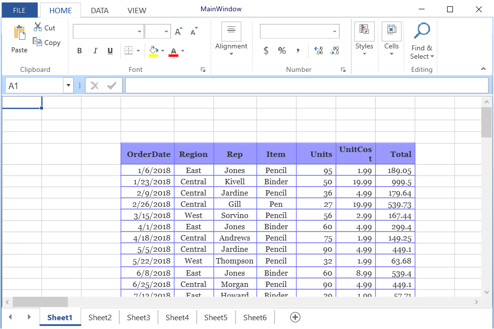

# How to Hide or Remove Headers in WPF Spreadsheet?

This example demonstrates how to hide or remove the headers in all the sheets of a workbook in [WPF Spreadsheet](https://www.syncfusion.com/wpf-controls/spreadsheet) (SfSpreadsheet).

To hide or remove the headers in all the sheets of a workbook, the following events can be used.

* WorkbookLoaded
* WorksheetAdded

`WorkbookLoaded` event is used to disable headers when the workbook is loaded. In that event, `SetHidden` method is used to set the row height and column width as zero to hide row and column headers.

`WorksheetAdded` event is used to disable header when the sheets are added dynamically. In this event, the `SetRowColumnHeadersVisibility` method is used to disable header cells.

``` csharp
//Event Subscription
 spreadsheet.WorkbookLoaded += Spreadsheet_WorkbookLoaded;
 this.spreadsheet.WorksheetAdded += Spreadsheet_WorksheetAdded;
 spreadsheet.Open("..\\..\\Data\\sample excel file.xlsx");
//Event Customization
private void Spreadsheet_WorksheetAdded(object sender, WorksheetAddedEventArgs args)
  {
      //To hide header cells visibility 
      spreadsheet.SetRowColumnHeadersVisibility(false);
   }
private void Spreadsheet_WorkbookLoaded(object sender, WorkbookLoadedEventArgs args) 
 {    
//To hide the Header cells visibility 
  foreach (var worksheet in spreadsheet.Workbook.Worksheets)
  {
     var grid = spreadsheet.GridCollection[worksheet.Name];
     grid.RowHeights.SetHidden(0, 0, true);
     grid.ColumnWidths.SetHidden(0, 0, true);
   }
 }
```

